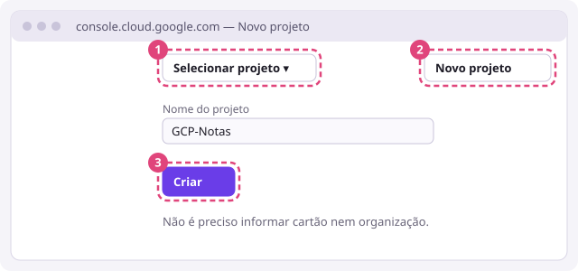
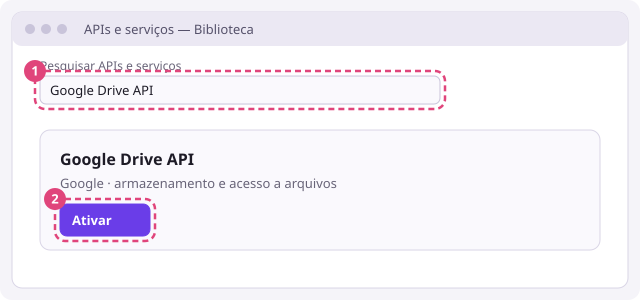
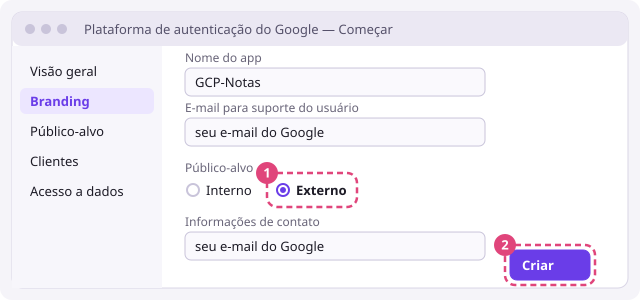
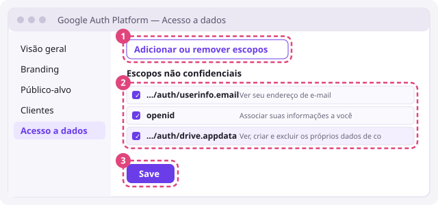
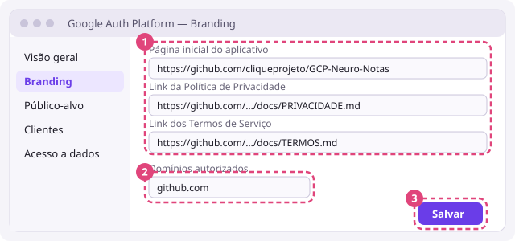
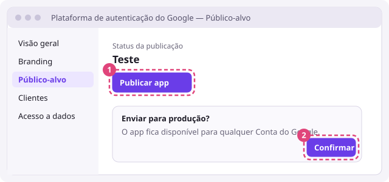
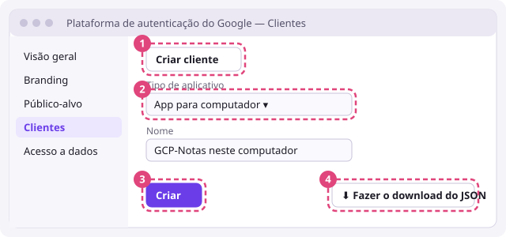
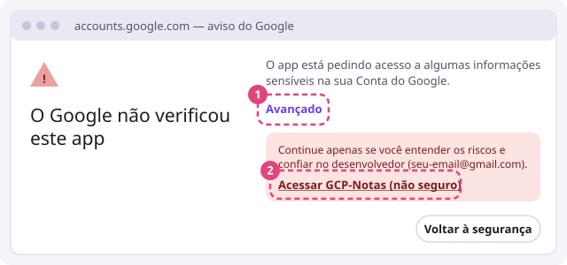
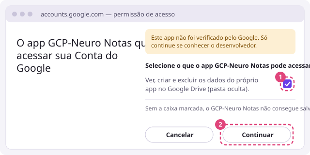

# Google Drive: backup e sincronização — passo a passo

O GCP-Neuro Notas não tem servidor: o app conversa direto com o **seu** Google Drive. Para isso o Google exige um **cadastro de aplicativo (cliente OAuth)**. Cada pessoa cria o próprio cadastro, de graça, em uns 10 minutos:

- **Sem custo e dentro da cota gratuita** da Google Drive API (cada cadastro tem a sua cota).
- **Sem verificação do Google**: o app só pede escopos **não confidenciais** — `drive.appdata` (uma pasta oculta, exclusiva do app), `userinfo.email` e `openid`. Ele não vê nenhum outro arquivo do seu Drive.
- **Privado**: o que vai para o Drive já sai **criptografado** com a chave do seu cofre.

> As ilustrações abaixo usam dados de exemplo. Nunca publique o seu ID de cliente, a chave secreta ou o arquivo `client_secret…json`.

Dentro do app, o mesmo tutorial (com botões que abrem cada página e copiam os links) fica em **Configurações → Backup e sincronização → Configurar → Passo a passo do Google**.

## 1. Crie um projeto
Acesse <https://console.cloud.google.com/projectcreate>, dê o nome **GCP-Neuro Notas** e clique em **Criar**. Não é preciso cartão nem faturamento.

## 2. Ative a Google Drive API
Em <https://console.cloud.google.com/apis/library/drive.googleapis.com>, confira o projeto no alto e clique em **Ativar**.

## 3. Preencha os dados do aplicativo
Em <https://console.cloud.google.com/auth/overview>, clique em **Começar**: nome **GCP-Neuro Notas**, e-mail de suporte (o seu), público **Externo**, e-mail de contato. Aceite a política de dados do Google e clique em **Criar**.

## 4. Adicione os escopos (Acesso a dados)
Em **Acesso a dados** → **Adicionar ou remover escopos**, marque:

- `.../auth/drive.appdata`
- `.../auth/userinfo.email`
- `openid`

Clique em **Atualizar** e depois em **Save**. Os três aparecem em **Escopos não confidenciais**.

## 5. Complete o Branding com os links
O Google só libera **Publicar app** depois disso. Em **Branding**:

| Campo | Valor (pode usar os do projeto) |
|---|---|
| Página inicial | `https://github.com/cliqueprojeto/GCP-Neuro-Notas` |
| Política de Privacidade | `https://github.com/cliqueprojeto/GCP-Neuro-Notas/blob/claude/epic-bohr-f7xkw7/docs/PRIVACIDADE.md` |
| Termos de Serviço | `https://github.com/cliqueprojeto/GCP-Neuro-Notas/blob/claude/epic-bohr-f7xkw7/docs/TERMOS.md` |
| Domínio autorizado | `github.com` |

Clique em **Salvar**. **Não envie logotipo**: com logotipo o Google passa a exigir verificação.

## 6. Publique o aplicativo
Em **Público-alvo**, clique em **Publicar app** → **Confirmar**. O status fica **Em produção**. Sem isso o Google desconecta a conta a cada 7 dias.

## 7. Crie o cliente e baixe o JSON
Em **Clientes** → **Criar cliente**: tipo **App para computador**, um nome qualquer → **Criar**. Na janela, clique em **Fazer o download do JSON** (`client_secret…json`). A chave secreta só aparece nesse momento.

## 8. Entregue o arquivo ao app
No app: **Configurações → Backup e sincronização → Configurar → Passo a passo do Google → Escolher arquivo JSON**. Depois clique em **Conectar**.

## 9. Primeiro login
Se aparecer "O Google não verificou este app", é esperado (o cadastro é seu): **Avançado → Acessar GCP-Neuro Notas**. Marque o acesso à pasta do app no Drive e clique em **Continuar**.

## Compartilhar com pessoas próximas
Quem já configurou pode usar **Exportar configuração** (no mesmo tutorial) e enviar o arquivo `gcp-neuro-notas-google.json` **só para quem confia**; a pessoa usa **Importar configuração**. Cada um continua com o próprio Drive e o próprio cofre.

## Para quem compila o app
Também é possível embutir o cadastro no build com as variáveis `VITE_GOOGLE_CLIENT_ID` e `VITE_GOOGLE_CLIENT_SECRET` (veja `.env.example`). As versões públicas do GitHub **não** trazem cadastro embutido: cada usuário usa o próprio.
